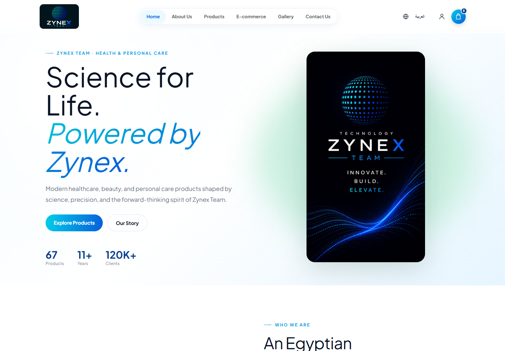
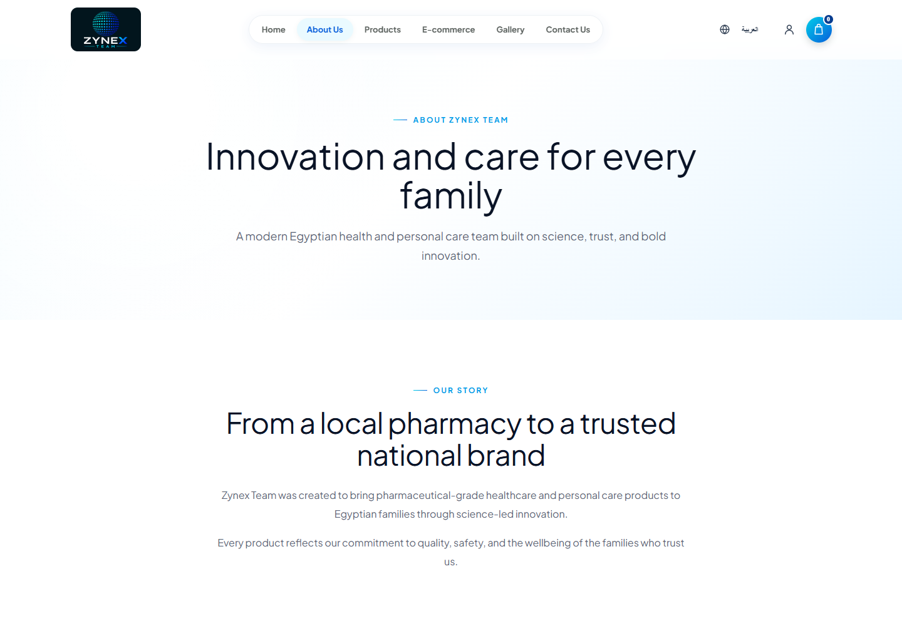
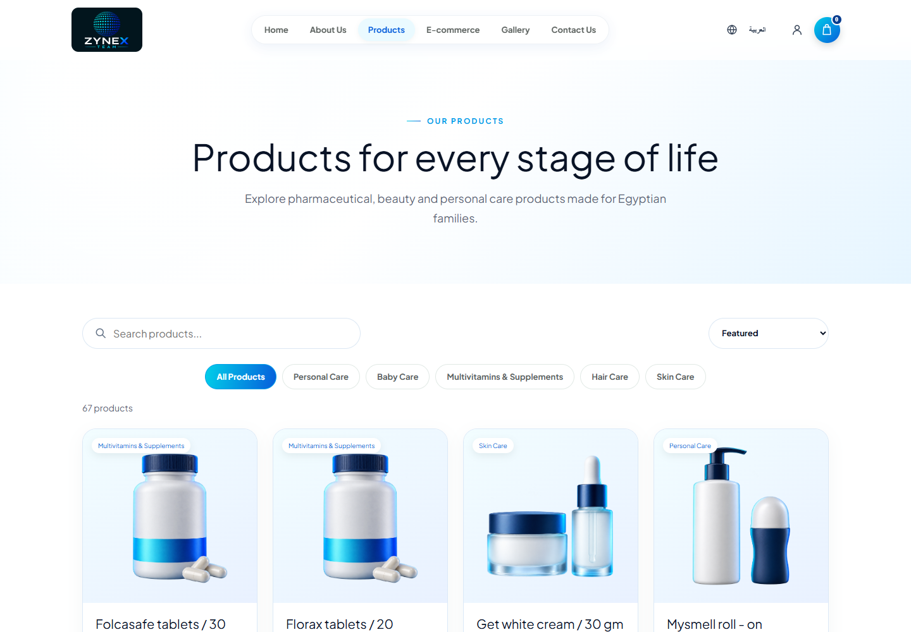
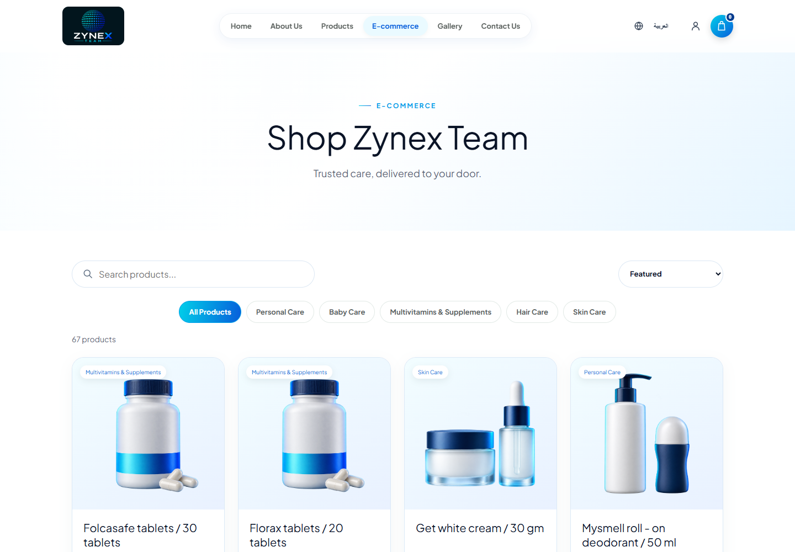

# Zynex Health & Personal Care

منصة تجارة إلكترونية ثنائية اللغة لمنتجات الصحة والجمال والعناية الشخصية، مصممة لتقديم تجربة شراء سهلة وآمنة على الكمبيوتر والهاتف.

> هذا المستودع مخصص لعرض المشروع فقط. الكود المصدري محفوظ في مستودع خاص.

## نظرة عامة

تقدم المنصة كتالوجًا متكاملًا يضم 67 منتجًا موزعًا على خمس فئات رئيسية، مع البحث والتصفية والشراء وإتمام الطلب من خلال تجربة متجاوبة باللغتين العربية والإنجليزية.

## المميزات الرئيسية

- دعم اللغتين العربية والإنجليزية.
- 67 منتجًا موزعًا على خمس فئات.
- البحث والتصفية وترتيب المنتجات.
- صفحات تفصيلية لكل منتج.
- متجر إلكتروني وسلة مشتريات.
- ملف بيانات خاص بالتوصيل.
- عملية Checkout متكاملة.
- دعم الدفع عند الاستلام.
- نموذج تواصل وربط بخدمة WhatsApp.
- واجهة متجاوبة مع الكمبيوتر والهاتف.
- REST API للمنتجات والطلبات ورسائل التواصل.

## فئات المنتجات

- Personal Care
- Baby Care
- Multivitamins & Supplements
- Hair Care
- Skin Care

## صور المشروع

### الصفحة الرئيسية

### من نحن

### كتالوج المنتجات

### المتجر الإلكتروني

## التقنيات المستخدمة

- HTML5
- CSS3
- Vanilla JavaScript
- Node.js
- Express.js
- REST API
- JSON Data Storage
- Helmet
- CORS
- Node.js Test Runner

## الأمان والاعتمادية

- Security Headers باستخدام Helmet.
- سياسات CORS للتحكم في الاتصال بالـAPI.
- تحديد معدل الطلبات والتحقق من البيانات المدخلة.
- Honeypot لحماية النماذج العامة.
- إعادة حساب أسعار الطلبات على الخادم.
- Anti-Tampering Checksum.
- اختبارات تلقائية للـBackend.

## فريق التطوير

تم تصميم وتطوير المشروع بواسطة **Zynex Team**.

© 2026 Zynex Team. All rights reserved.
